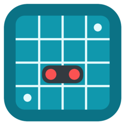
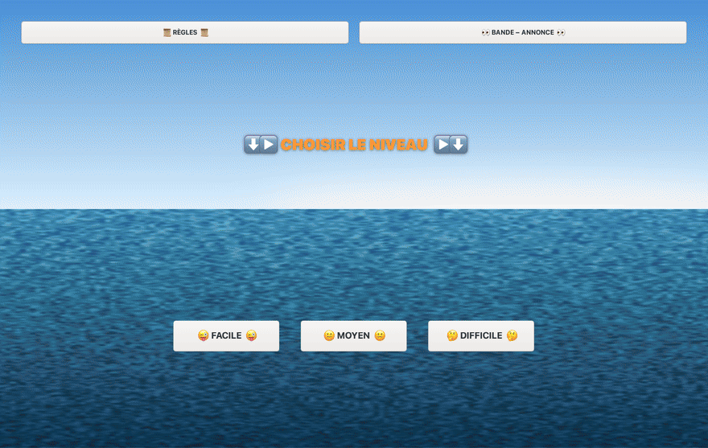
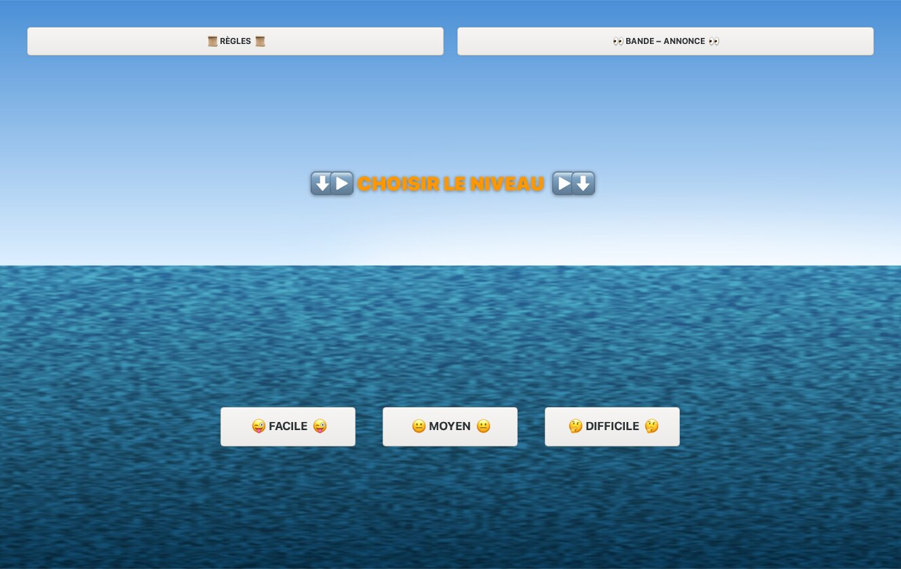
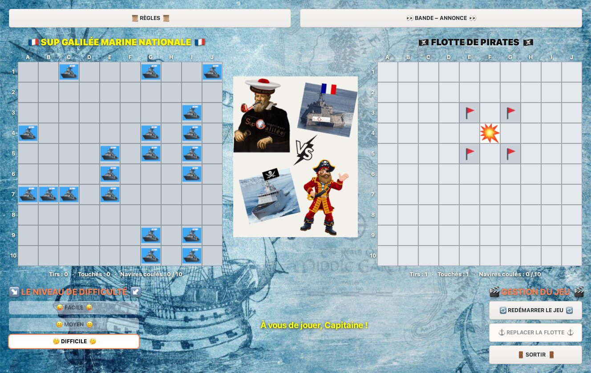
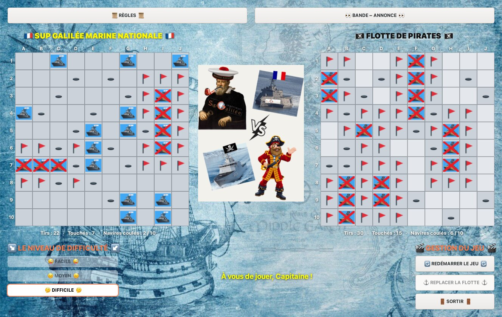
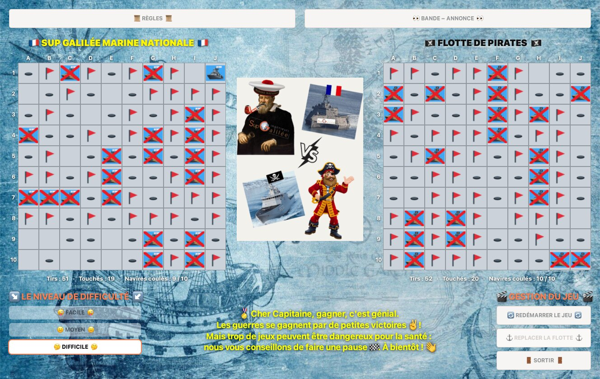
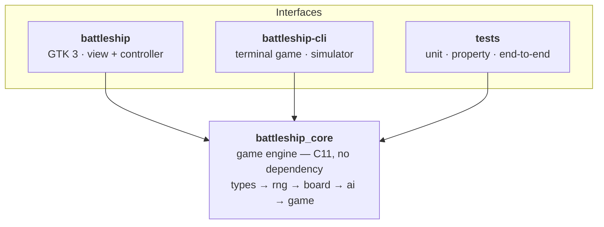
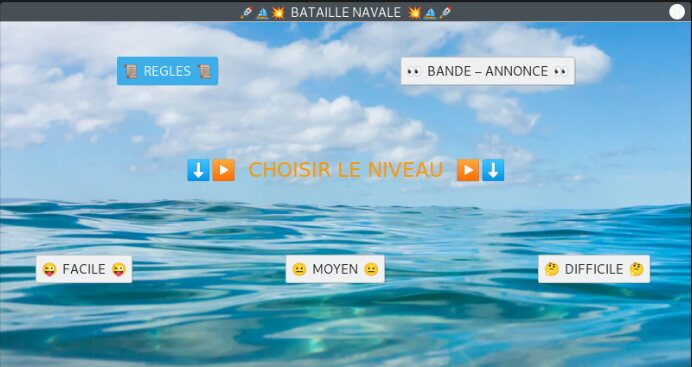
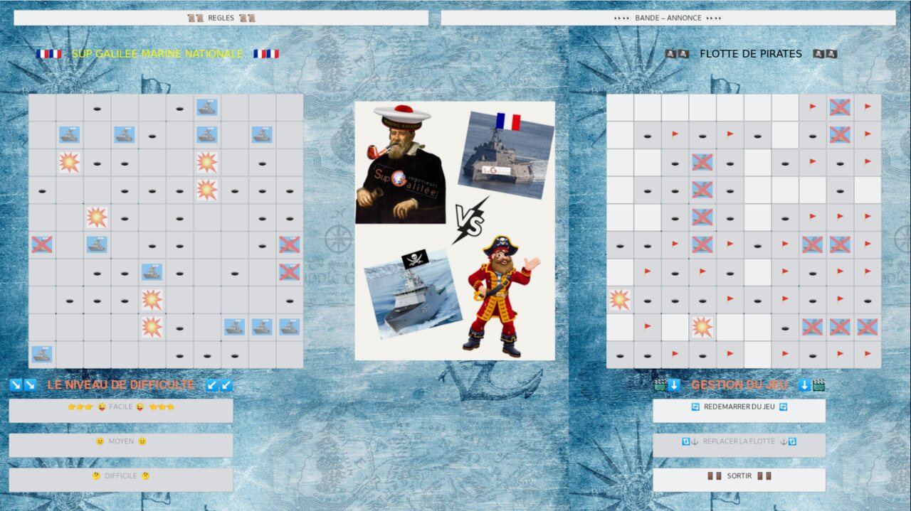

<div align="center">



# Battleship

**Bataille Navale — the pen-and-paper classic, in C11 and GTK 3**

[](https://github.com/DmytroPalahin/Battleship/actions/workflows/ci.yml)
[](https://github.com/DmytroPalahin/Battleship/actions/workflows/codeql.yml)
[](https://github.com/DmytroPalahin/Battleship/actions/workflows/docs.yml)
[](https://github.com/DmytroPalahin/Battleship/releases/latest)
[](LICENSE)


[](https://www.conventionalcommits.org)
[](CONTRIBUTING.md)



<sub>A complete game, played by the program against itself. This animation is produced by the
<a href="#quality">end-to-end test</a>, not recorded by hand.</sub>

</div>

---

You command the *Sup Galilée* navy against a fleet of pirates on a 10 × 10 grid. Ten ships
each, none of them touching another, and the first fleet sunk loses.

The project began in 2023 as a university assignment — a single 2 666-line C file. Version 2 is
a ground-up rewrite that keeps the game and replaces everything underneath: a model / view /
controller architecture, a game engine with no dependency, three measurable computer
opponents, a test-suite, and a build and release pipeline.

## Highlights

- **A real engine.** The rules live in a dependency-free C11 library: no GTK, no `malloc`, no
  global state. A whole match is one 800-byte structure.
- **Two interfaces, one model.** A GTK 3 application and a terminal game drive the same engine
  — the proof that the model is really independent of its view.
- **An opponent you can measure.** Three levels whose strength is benchmarked over thousands of
  seeded games, and an AI that *cannot* cheat: it never receives the ship positions.
- **Reproducible.** Every game comes from a seed. `--seed 7` replays the same match on Linux
  and macOS, bit for bit.
- **Tested where it matters.** 54 unit cases, property tests over 2 250 full matches,
  sanitizers, static analysis, and a GUI test that plays a whole game through real widget
  clicks.
- **One file to ship.** Images, sounds and style sheet are compiled into the executable.

## Screenshots

|                        Choose a level                         |                        Fleets at the ready                        |
| :-----------------------------------------------------------: | :---------------------------------------------------------------: |
|                        |                       |
|                      **In the thick of it**                   |                            **Victory**                            |
|                     |                     |

## Quick start

### 1. Install the dependencies

| System          | Command                                                                                       |
| --------------- | --------------------------------------------------------------------------------------------- |
| Debian / Ubuntu | `sudo apt install build-essential cmake pkg-config libgtk-3-dev libgstreamer1.0-dev`           |
| Fedora          | `sudo dnf install gcc cmake pkgconf-pkg-config gtk3-devel gstreamer1-devel`                    |
| macOS           | `brew install cmake pkg-config gtk+3 gstreamer`                                               |

GStreamer is optional: without it the game builds without sound. GTK itself is only needed
for the graphical interface (see [Headless build](#headless-build)).

### 2. Build, test, play

```bash
git clone https://github.com/DmytroPalahin/Battleship.git
cd Battleship
make test     # configure, compile and run the test-suite
make run      # start the game
```

`make` is only a shortcut for the CMake presets. The explicit form is:

```bash
cmake --preset release
cmake --build --preset release
ctest --preset release
./build/release/src/ui/battleship
```

Run `make help` for the other everyday commands (`format`, `lint`, `asan`, `coverage`,
`report`, `package`…).

### Headless build

The engine, the terminal game and the tests need nothing but a C11 compiler and CMake:

```bash
cmake --preset headless && cmake --build --preset headless && ctest --preset headless
./build/headless/src/cli/battleship-cli play
```

## How to play

| Rule            |                                                                                   |
| --------------- | --------------------------------------------------------------------------------- |
| **Fleet**       | 1 × four cells, 2 × three cells, 3 × two cells, 4 × one cell                      |
| **Placement**   | Ships never touch, not even by a corner. Fleets are drawn at random; redraw yours as often as you like before the first shot |
| **Turn**        | Fire at an enemy cell. A hit earns another shot; a miss passes the turn           |
| **Flags**       | 🚩 marks a cell where no ship can be — worked out for you from the no-touch rule  |
| **End**         | The first fleet entirely sunk loses                                               |

**Controls.** Click an enemy cell, or move with the arrow keys and press <kbd>Space</kbd>.
<kbd>F11</kbd> toggles full screen.

**In a terminal.** `battleship-cli play` offers the same game with typed coordinates (`B7`),
plus `hint`, `shuffle` and `quit`.

## The computer opponent

Each level adds one skill to the one below it.

| Level                  | What it knows how to do                                                | Shots to sink a fleet |
| ---------------------- | ---------------------------------------------------------------------- | --------------------: |
| 😜 **Facile** (easy)   | Fires at random, never twice at the same cell                           |          96.2 ± 4.1   |
| 😐 **Moyen** (medium)  | Also skips every cell the rules prove to be empty                       |          65.8 ± 6.1   |
| 🤔 **Difficile** (hard) | Also finishes off wounded ships and hunts where a ship is most likely   |          55.3 ± 6.8   |

Head-to-head, with the real "hit and shoot again" rule, **hard beats medium in 87.5 % of
matches**, and medium beats easy in 9 999 matches out of 10 000.

These figures are not estimates. They come from the simulator shipped with the game, and you
can reproduce them exactly:

```console
$ battleship-cli simulate --games 10000 --seed 1
Shots needed to sink a random fleet (20 decks on 100 cells; lower is better)
level       mean  stddev   min   p50   p90   max
easy       96.19    4.10    69    97   100   100
medium     65.83    6.07    44    66    74    85
hard       55.27    6.80    28    56    64    79

Head-to-head: matches won by the row level against the column level (%)
            easy  medium    hard
easy        49.6     0.0     0.0
medium     100.0    49.7    12.0
hard       100.0    87.5    50.0
```

The hard level builds a probability map: for every ship still afloat it counts every position
consistent with what the shots have revealed, and fires where the most positions overlap.
The levels themselves were chosen from measurements of several candidate strategies — see
[ADR 0003](docs/adr/0003-stateless-ai-on-public-knowledge.md).

## Architecture



**Dependencies point inwards**: the engine knows nothing about how it is displayed. CI builds
and tests it on a machine without GTK, so the rule cannot be broken by accident.

- **Model** — [`include/battleship/`](include/battleship), [`src/core/`](src/core). Placement,
  shots, deductions, turn order, AI. Pure functions on plain structures.
- **View** — [`src/ui/view.c`](src/ui/view.c). Every widget, and no rule. It is driven in game
  vocabulary (`bs_view_set_cell(…, BS_LOOK_HIT, …)`) and reports gestures as intentions
  (`cell_activated`). No `GtkWidget` crosses its interface; all styling is in
  [`assets/style.css`](assets/style.css).
- **Controller** — [`src/ui/controller.c`](src/ui/controller.c). Asks the model to play, then
  re-synchronises the whole view from it. The view holds no game state, so it cannot go stale.

The full tour, with the state machine and a sequence diagram of a shot, is in
[**docs/architecture.md**](docs/architecture.md); the reasoning behind each choice is in the
[decision records](docs/adr).

<details>
<summary><b>Project layout</b></summary>

```
.
├── include/battleship/   public API of the engine
├── src/
│   ├── core/             game engine (the model)
│   ├── cli/              terminal game and AI simulator
│   └── ui/               GTK application (view, controller, shell)
├── assets/               images, sounds, style sheet → compiled into the executable
├── tests/                unit, property and CLI tests
├── docs/
│   ├── architecture.md   how it fits together
│   ├── adr/              architecture decision records
│   ├── report/           the project report (LaTeX, French)
│   └── screenshots/
├── cmake/                build modules
├── packaging/            desktop entry, AppStream metadata, icon
└── .github/              CI/CD workflows, issue and PR templates
```

</details>

## Quality

| Check               | What it does                                                               | Where                    |
| ------------------- | -------------------------------------------------------------------------- | ------------------------ |
| Build matrix        | GCC and Clang on Ubuntu, Apple Clang on macOS; Debug and Release           | `ci.yml` → *build*       |
| Warnings as errors  | `-Wall -Wextra -Wpedantic -Wconversion -Wshadow` and friends               | every build              |
| Unit and property tests | 54 cases; 2 250 matches with every invariant re-checked after each shot | `ctest`                  |
| Sanitizers          | The whole suite under AddressSanitizer and UndefinedBehaviorSanitizer      | `ci.yml` → *sanitizers*  |
| Coverage            | 98 % of the engine's lines; the job fails below 95 %                       | `ci.yml` → *coverage*    |
| Static analysis     | clang-tidy, cppcheck, CodeQL                                               | `ci.yml`, `codeql.yml`   |
| Documentation       | The report (LaTeX) and the API reference (Doxygen) are rebuilt on change   | `docs.yml`               |
| Formatting          | clang-format, checked on every push                                        | `ci.yml` → *format*      |
| Independence        | Engine and CLI built and tested without GTK installed                      | `ci.yml` → *headless*    |
| End-to-end          | A full game played through the real widgets under Xvfb; any GTK warning is fatal; a screenshot is kept | `ci.yml` → *build* |
| Release             | On a `v*` tag: packages, checksums, build provenance, report PDF           | `release.yml`            |

Everything CI runs can be run locally with the same preset names: `make test`, `make asan`,
`make coverage`, `make lint`.

## Command line

```console
$ battleship --help
  -l, --level=LEVEL    Start at a level without showing the menu: easy, medium or hard
  -s, --seed=N         Seed of the first game, to replay it
  -m, --mute           Disable the sound effects
  -V, --version        Show the version and exit

$ battleship-cli --help
  play       play against the computer in the terminal
  simulate   benchmark the three AI levels against random fleets
```

Sound goes to the system's default output. Set `BATTLESHIP_AUDIO_SINK` to the name of a
GStreamer sink (`pulsesink`, `alsasink`…) to send it elsewhere.

## Documentation

- 📐 [**Architecture**](docs/architecture.md) — modules, state machine, sequence of a shot
- 🧭 [**Decision records**](docs/adr) — why it is built this way
- 📚 **API reference** — `make docs` generates it from the public headers with Doxygen
- 📄 [**Project report**](https://github.com/DmytroPalahin/Battleship/releases/latest/download/battleship-report.pdf)
  — the full write-up, in French ([LaTeX sources](docs/report))
- 📝 [**Changelog**](CHANGELOG.md)

## History

| Version                                                                       | Date | What it was                                                                    |
| ----------------------------------------------------------------------------- | ---- | ------------------------------------------------------------------------------ |
| [**v1.0.0**](https://github.com/DmytroPalahin/Battleship/releases/tag/v1.0.0) | 2023 | The original assignment: one C file, GTK 3, three levels. By Dmytro Palahin and Ivanna Makam |
| [**v2.0.0**](https://github.com/DmytroPalahin/Battleship/releases/tag/v2.0.0) | 2026 | The rewrite described on this page                                             |

The original code is preserved under the `v1.0.0` tag. What changed, and which defects of the
first version the rewrite removed, is listed in the [changelog](CHANGELOG.md).

<details>
<summary><b>Version 1 screenshots (2023)</b></summary>

|                                                     |                                                    |
| :-------------------------------------------------: | :------------------------------------------------: |
|             |        |

</details>

## Roadmap

- [ ] Two-player games over the network (the model is already interface-agnostic)
- [ ] Manual fleet placement by drag and drop
- [ ] Translations with gettext (every string already lives in one file)
- [ ] GTK 4 port
- [ ] Flatpak package

## Contributing

Issues and pull requests are welcome. [CONTRIBUTING.md](CONTRIBUTING.md) explains how to set
up, what CI expects and how commits are written. Please also read the
[code of conduct](CODE_OF_CONDUCT.md).

## Authors

<table>
  <tr>
    <td align="center" width="220">
      <a href="https://github.com/DmytroPalahin">
        <br>
        <b>Dmytro Palahin</b>
      </a><br>
      <sub>Original game · v2 architecture and rewrite · maintainer</sub>
    </td>
    <td align="center" width="220">
      <br>
      <b>Ivanna Makam</b><br>
      <sub>Original game (2023): design, interface, report</sub>
    </td>
  </tr>
</table>

Written for the course *Initiation aux interfaces graphiques* taught by Sophie Toulouse at
[Sup Galilée](https://www.sup-galilee.univ-paris13.fr/) (Université Sorbonne Paris Nord), whose
model / view / controller method is the backbone of the architecture. See
[AUTHORS.md](AUTHORS.md).

## License

The source code is released under the [MIT License](LICENSE).

The artwork and sounds in `assets/` are a different matter: part of them is third-party
material collected for the original school project, and is **not** covered by the MIT licence.
See [assets/README.md](assets/README.md) before redistributing.
