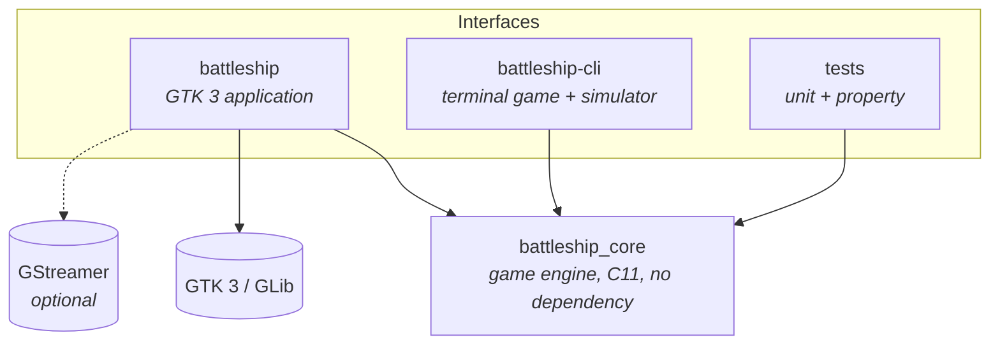
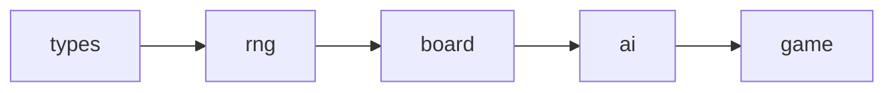
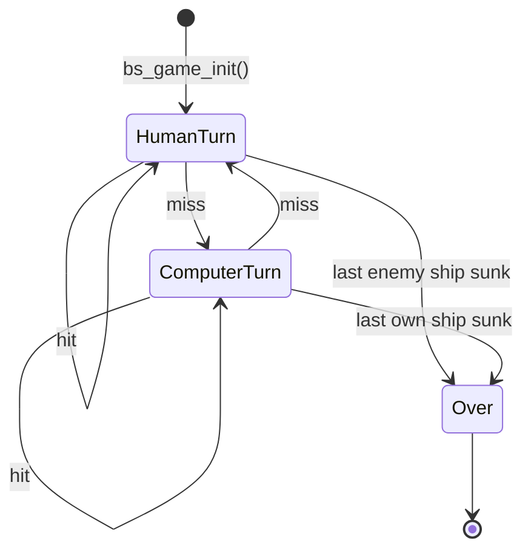
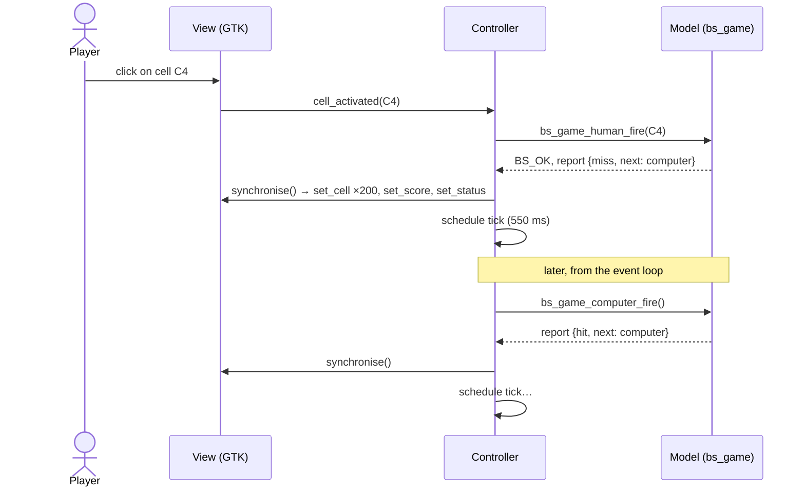

# Architecture

This document explains how the program is organised and why. It is the map to read before
changing anything; the [report](report/) tells the same story at length, in French.

- [The one rule](#the-one-rule)
- [Modules](#modules)
- [The model: a game engine with no dependency](#the-model-a-game-engine-with-no-dependency)
- [The view: widgets and nothing else](#the-view-widgets-and-nothing-else)
- [The controller: one function to keep them in step](#the-controller-one-function-to-keep-them-in-step)
- [What happens when you fire](#what-happens-when-you-fire)
- [The computer opponent](#the-computer-opponent)
- [Testing strategy](#testing-strategy)
- [Design decisions](#design-decisions)

## The one rule

**Dependencies point inwards.** The game engine knows nothing about how it is displayed; the
interfaces know the engine; nothing knows the interfaces.



The build enforces it: `battleship_core` is a static library whose only include path is
`include/`, and it is compiled and tested in CI **without GTK installed** (the `headless`
preset). If someone adds a GTK call to the engine, that job stops compiling.

Three programs are built on the engine. Having more than one is not decoration: a second
interface is the only real proof that the first one has not leaked into the model.

## Modules

```
include/battleship/      public API of the engine
  types.h                coordinates, status codes, constants
  rng.h                  seedable random numbers
  board.h                one fleet: placement, shots, derived knowledge
  ai.h                   computer opponent
  game.h                 a match: turn order, score, end of game
src/core/                the engine                         ── MODEL
src/cli/                 terminal interface and simulator   ── a second view + controller
src/ui/                  GTK application
  view.[ch]              every widget                       ── VIEW
  controller.[ch]        reactions to the user              ── CONTROLLER
  app.[ch]               command line, lifetime of the model
  audio*.c               sound: GStreamer or no-op
  texts.h                all user-visible strings (French)
assets/                  images, sounds, style sheet → compiled into the executable
tests/                   test-suite
```

Inside the engine the modules form a strict chain, each one built only on those before it:



## The model: a game engine with no dependency

### State without allocation

A whole match fits in one plain structure, `bs_game` (800 bytes). The engine never
calls `malloc`: no allocation can fail, nothing can leak, and copying a game is an assignment.
That is what makes it cheap to run millions of simulated games in the tests.

### Two kinds of information on a board

`bs_board` holds the **secret** (where the ships are) and the **public** shot history.
The public part is exported as a separate structure:

```c
typedef struct bs_knowledge {
    uint8_t state[BS_CELL_COUNT];                     /* what each cell revealed   */
    uint8_t afloat_by_length[BS_MAX_SHIP_LENGTH + 1]; /* which ships are left      */
} bs_knowledge;
```

The AI receives a `bs_knowledge` and nothing else. It cannot cheat, not by discipline but by
construction: the ship positions are simply not in its arguments.

### Deduction lives in the model

Ships may not touch, even diagonally. So a hit proves that its four diagonal neighbours are
water, and a sunk ship proves the same for its whole surroundings. The board records those
cells as `BS_CELL_EXCLUDED` the moment a shot proves them. Every interface then shows the same
flags, and the AI levels differ only in how much of that knowledge they use.

### A match is a small state machine



Each call performs **one** step and returns a report of what changed. The engine never
blocks, never sleeps and never calls back. Pacing is entirely the caller's business: the GTK
application waits half a second between two computer shots, the simulator waits zero.

### Errors are values

Every operation that can be refused returns a `bs_status`. A refused operation leaves the
state untouched — for example firing out of turn changes neither the board nor the score.
The tests check this explicitly.

### Randomness is an argument

The engine never calls `rand()`. Every random decision draws from a `bs_rng` owned by the
caller (xoshiro256\*\*, seeded through SplitMix64, with unbiased bounded draws). A seed
therefore replays a complete match, on every platform: the reference outputs of the generator
are pinned in the tests.

## The view: widgets and nothing else

`view.h` is the complete interface of the view. Two things are worth noticing in it.

**No `GtkWidget` crosses it.** The controller tells the view *what* to show in the vocabulary
of the game — "this cell looks like a hit", "the status line says…" — never *how*:

```c
void bs_view_set_cell(bs_view *view, bs_player owner, bs_coord cell,
                      bs_cell_look look, bool sensitive);
```

**User gestures come back as intentions**, through a table of callbacks:

```c
typedef struct bs_view_actions {
    void (*level_chosen)(bs_difficulty level, gpointer user_data);
    void (*cell_activated)(bs_coord cell, gpointer user_data);
    void (*reshuffle_requested)(gpointer user_data);
    /* ... */
} bs_view_actions;
```

The course this project comes from builds the controller by fetching widgets from the view
(`vue_get_bouton()`) and connecting signals itself, and notes that function pointers would be
more elegant. This is that variant: the view connects its own signals and reports intentions.

The appearance is not in C at all. A cell is given a class name (`hit`, `sunk`, `excluded`…)
and [`assets/style.css`](../assets/style.css) decides what the class looks like.

```
GtkApplicationWindow
└── GtkStack
    ├── "menu"  GtkBox
    │           ├── info bar: [Règles] [Bande-annonce]
    │           ├── title
    │           └── [Facile] [Moyen] [Difficile]
    └── "game"  GtkBox
                ├── info bar
                ├── GtkBox ── own fleet:   title · GtkGrid 10×10 · score
                │          ── illustration
                │          └─ enemy fleet: title · GtkGrid 10×10 · score
                └── GtkBox ── level chips · status · [Redémarrer] [Replacer] [Sortir]
```

## The controller: one function to keep them in step

The controller owns the view and borrows the model. It has one central function:

```c
static void synchronise(bs_controller *controller);
```

It reads the whole model and pushes it to the view: 200 cells, two scores, one status line.
It is called after every change. Because the view keeps no game state of its own, it cannot
drift out of sync with the model — there is no incremental update to get wrong. Two hundred
style-class comparisons per move is nothing; correctness by construction is worth far more.

The computer's turn is driven by a GLib timeout that fires **one shot per tick**. Between
ticks the event loop redraws, so the player watches each shot land and the window never
freezes (the original version computed the whole enemy turn inside the click handler).

## What happens when you fire



## The computer opponent

The AI is a pure function `(level, knowledge, rng) → cell`. It has no memory: everything it
needs is recomputed from the board. Each level adds one skill to the previous one.

| Level  | Skill added                                                              | Shots to sink a fleet¹ |
| ------ | ------------------------------------------------------------------------ | ---------------------: |
| Easy   | Fires at random, never twice at the same cell                            |                   96.2 |
| Medium | Skips every cell the rules prove to be water                             |                   65.8 |
| Hard   | Finishes off wounded ships; hunts where a ship is most likely to be      |                   55.3 |

¹ Mean over 10 000 random fleets, `battleship-cli simulate --games 10000 --seed 1`.

The hard level builds a **density map**. For every ship still afloat it enumerates every
position consistent with what is known, and counts, for each cell, how many of those positions
cover it. A position is consistent when all its cells are unexplored or hits on a ship still
afloat, when it is not made of hits only (that ship would be sunk), and when no hit lies next
to it without belonging to it (ships never touch). While a ship is wounded, only positions
that explain a hit are counted, which turns the same code into a "finish it off" routine.

## Testing strategy

| Layer                 | How it is tested                                                         |
| --------------------- | ------------------------------------------------------------------------ |
| Engine, unit          | 5 test programs, 54 cases: every public function, every error path       |
| Engine, properties    | 2 250 full matches with every invariant re-derived after each shot       |
| Engine, memory safety | The same tests under AddressSanitizer and UndefinedBehaviorSanitizer     |
| Strategies            | Seeded regression: the levels must stay ordered by measured strength     |
| Terminal interface    | Scripted session compared with the expected transcript                   |
| Reproducibility       | Two simulator runs with one seed must print identical bytes              |
| GTK interface         | A complete game played through real widget clicks under Xvfb, with any GTK warning fatal |

The engine's own tests reach 98 % line coverage; CI fails below 95 %.

The GTK test deserves a word. `battleship --autoplay` plays both sides, but the human's shots
are not sent to the model: the controller asks the view to *click the button*. Each shot then
travels the full path of a user action — widget, signal, view callback, controller, model —
so the test exercises the interface for real, and it saves a screenshot as a build artefact.

## Design decisions

The reasoning behind the main choices is recorded as short decision records:

- [ADR 0001 — Model / view / controller with a dependency-free engine](adr/0001-mvc-with-a-dependency-free-engine.md)
- [ADR 0002 — CMake presets as the single source of build truth](adr/0002-cmake-presets.md)
- [ADR 0003 — A stateless AI fed with public knowledge only](adr/0003-stateless-ai-on-public-knowledge.md)
- [ADR 0004 — Assets compiled into the executable](adr/0004-assets-as-gresource.md)
- [ADR 0005 — A test harness of our own](adr/0005-in-tree-test-harness.md)
